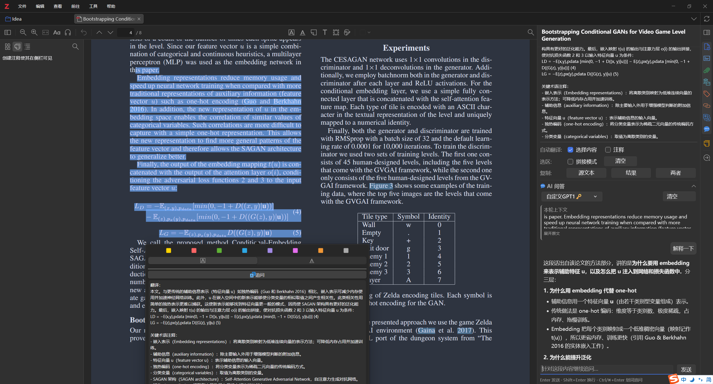

# AskTranslate for Zotero

[](LICENSE)
[](https://github.com/windingwind/zotero-pdf-translate)

**AskTranslate** 是由 clef233 独立维护的 Zotero 翻译与 AI 追问插件，基于 [Translate for Zotero（Zotero PDF Translate）](https://github.com/windingwind/zotero-pdf-translate) 二次开发，在原有翻译功能上增加 **AI 追问问答**：阅读论文时，选中一段文字、查看翻译，再直接在 Zotero 侧栏中继续提问。

例如，可以让 AI 解释术语、拆解公式、说明一段话的推理过程，或继续追问“为什么这样设计”。回答可复制，也可插入 Zotero 笔记或保存为新笔记。

原项目由 [windingwind](https://github.com/windingwind) 及其贡献者开发；AskTranslate 由 [clef233](https://github.com/clef233) 增加 AI 追问功能并维护，是独立衍生版本。功能修改始于 2026-09-11，本文档整理于 2026-10-17。

## 使用示例

下图展示了选中文本、划词翻译，以及在右侧「AI 问答」中提问“解释一下”的实际界面。点击图片可查看完整操作视频。

[](docs/res/follow-up-demo.mp4)

**[观看操作视频（MP4，约 31 秒）](docs/res/follow-up-demo.mp4)** · [查看动图演示](docs/res/chat.gif)

## 新增功能

- **划词追问**：在翻译弹窗中点击「追问」，或在阅读器中按 `Ctrl+Enter`（macOS 为 `⌘+Enter`），打开侧栏「AI 问答」。
- **结合阅读上下文**：将选中的原文、已有译文及所属文献的标题、摘要一起交给模型，围绕当前段落连续提问。
- **复用已配置的模型**：支持 ChatGPT、自定义 GPT、AzureGPT、Claude、Gemini，可在问答面板中切换已配置的服务。
- **流式回答**：逐步显示生成内容，可随时停止；回答完成后支持 Markdown 和 LaTeX 公式显示。
- **整理到笔记**：复制回答、插入当前打开的笔记，或将引用原文、问题和回答保存为新笔记。

继续保留原项目的 PDF、EPub、网页划词翻译，以及标题、摘要、批注、笔记翻译等功能。原有翻译服务配置可查阅 [保留的详细文档](docs/UPSTREAM_README.md#settings)。

## 安装

从 [最新正式版本](https://github.com/clef233/zotero-pdf-translate/releases/latest) 下载 **asktranslate.xpi**。首个独立版本为 **0.1.0**。

在 Zotero 中打开「工具 → 插件」，先停用原版 Translate 或之前安装的 AI 追问版，再点击齿轮 →「从文件安装插件」，选择 `asktranslate.xpi`，安装完成后重启 Zotero。

AskTranslate 使用独立插件 ID `asktranslate@clef233.github.io`，不会覆盖原版。此版本按单独启用验证，请只启用其中一个。

由于设置空间独立，首次安装需要在「设置 → AskTranslate」中重新配置翻译和模型服务；原先保存到 Zotero 的笔记不受影响。

从源码构建：

```bash
git clone https://github.com/clef233/zotero-pdf-translate.git
cd zotero-pdf-translate
npm ci
npm run build
```

建议使用 Node.js 22。构建成功后，安装包位于 `build/asktranslate.xpi`。

在 Zotero 中打开「工具 → 插件」，点击右上角齿轮，选择「从文件安装插件」，选中构建出的 `.xpi`。安装前请确认 Zotero 版本满足 [插件声明的版本范围](addon/manifest.json)。

### 自动更新与自动构建

AskTranslate 的自动更新来自本仓库的 `asktranslate-updates` Release，下载链接指向对应的 `asktranslate-v版本号` 正式版本，不跟随上游更新。

提交到 `main` 或手动运行 [Build 工作流](https://github.com/clef233/zotero-pdf-translate/actions/workflows/build.yml) 会自动构建 `.xpi`，可从该次运行的 Artifacts 下载。推送 `asktranslate-v*` 标签会构建并发布版本、校验值及更新清单。

## 开始追问

1. 打开 Zotero 的「设置 → AskTranslate → 服务」，配置一个支持问答的 LLM 服务，填写对应的接口、模型和密钥。使用第三方兼容接口时，可选择「自定义 GPT」。
2. 在 Zotero 阅读器中打开论文，选中需要理解的段落并翻译。
3. 点击翻译弹窗里的「追问」，或按 `Ctrl+Enter` / `⌘+Enter`。
4. 在右侧「AI 问答」中输入问题，例如“解释一下这段话”“这里为什么不用 one-hot 编码？”或“逐项解释这个公式”。
5. 按 `Enter` 发送，`Shift+Enter` 换行；生成过程中可以点击「停止」。继续输入问题即可追问。
6. 回答完成后，可使用「复制」「插入笔记」「存为新笔记」整理内容。

问答会复用所选服务的接口、模型、密钥等设置。默认优先使用问答面板选定的服务，其次是当前支持问答的翻译服务，再其次是其他已配置的问答服务。

### 设置与常见问题

| 问题                                | 处理方式                                                                                                                   |
| ----------------------------------- | -------------------------------------------------------------------------------------------------------------------------- |
| 翻译弹窗中没有「追问」              | 确认至少配置了一个支持问答的 LLM 服务，并在「设置 → AskTranslate → 用户界面」中启用「在弹窗中显示‘追问’」。                |
| 用 Google、DeepL 等翻译后能追问吗？ | 可以，另外配置一个支持问答的 LLM 服务即可，翻译和问答可以使用不同服务。                                                    |
| 如何调整回答风格？                  | 在「设置 → AskTranslate → 高级」中修改追问助手的系统提示词（`chatPrompt`）。                                               |
| 会发送哪些内容？                    | 当前选区、已有译文、可读取到的文献标题和摘要，以及保留的对话消息会发送到所选模型服务。不会自动读取整篇论文作为问答上下文。 |
| 对话会长期保存吗？                  | 当前对话保存在内存中，重启后不保留。需要留存的回答请使用「存为新笔记」。                                                   |
| 「插入笔记」没有写入笔记？          | 先打开一个笔记编辑器；没有打开的笔记时，回答会复制到剪贴板。也可以直接使用「存为新笔记」。                                 |

发送给模型的历史消息数量由 `chatMaxTurns` 控制，默认值为 `10`；超出限制时优先丢弃较早的消息，保留携带初始上下文的第一条消息。

## 开发

```bash
npm ci
npm run build
```

如需在 Zotero 中调试或运行测试，将 `.env.example` 复制为 `.env`，填写专用 Zotero 开发配置，再运行：

```bash
npm start
# 或在 Zotero 测试环境中运行测试
npm test
```

`.gitignore` 已排除本地环境配置、密钥文件、依赖、构建产物、缓存和日志；保留 `.env.example` 与 `package-lock.json`，便于复现开发环境。

项目使用 [Zotero Plugin Template](https://github.com/windingwind/zotero-plugin-template) 和 Zotero Plugin Scaffold。问题或建议请提交到 [本 fork 的 Issues](https://github.com/clef233/zotero-pdf-translate/issues)。

## 发布新版本

修改 `package.json` / `package-lock.json` 中的版本号，更新 `NOTICE` 中的版本与源码链接，在 `docs/releases/版本号.md` 记录变更并提交。

```bash
git tag asktranslate-v0.1.0
git push origin main
git push origin asktranslate-v0.1.0
```

上述命令展示首个版本的标签格式；后续发布请替换版本号。Release 工作流会检查标签和包版本一致，先验证安装包，再发布版本和自动更新清单。

## 许可证与致谢

本项目沿用 **[GNU Affero General Public License v3.0 or later（AGPL-3.0-or-later）](LICENSE)**。上游作者为 windingwind 及原项目贡献者，AskTranslate 维护者为 clef233，详见 [NOTICE](NOTICE)。安装包内附许可证、署名及第三方依赖声明。

感谢 [windingwind/zotero-pdf-translate](https://github.com/windingwind/zotero-pdf-translate) 及所有上游贡献者提供的翻译功能和插件基础。
